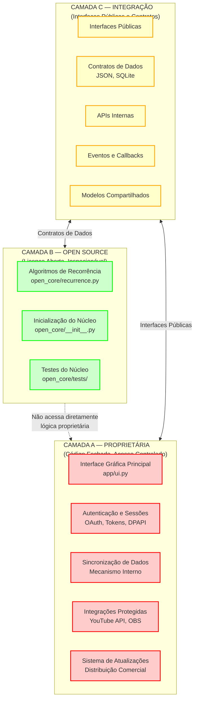
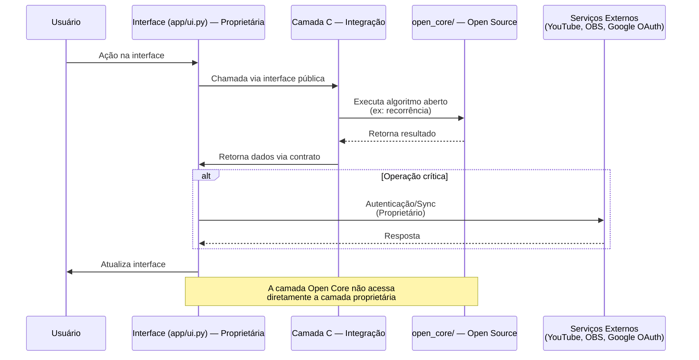
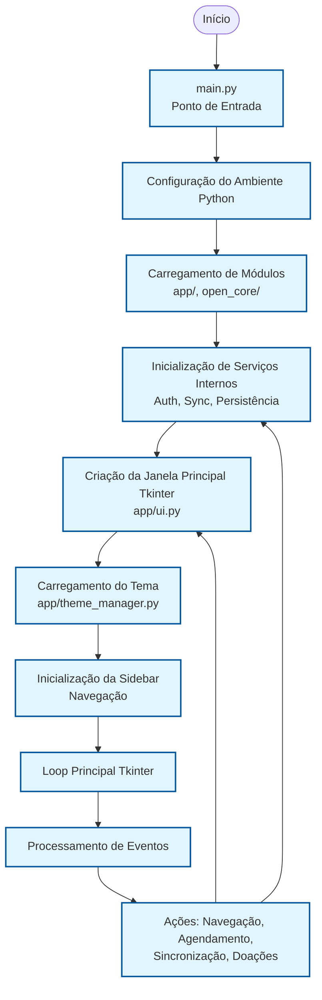
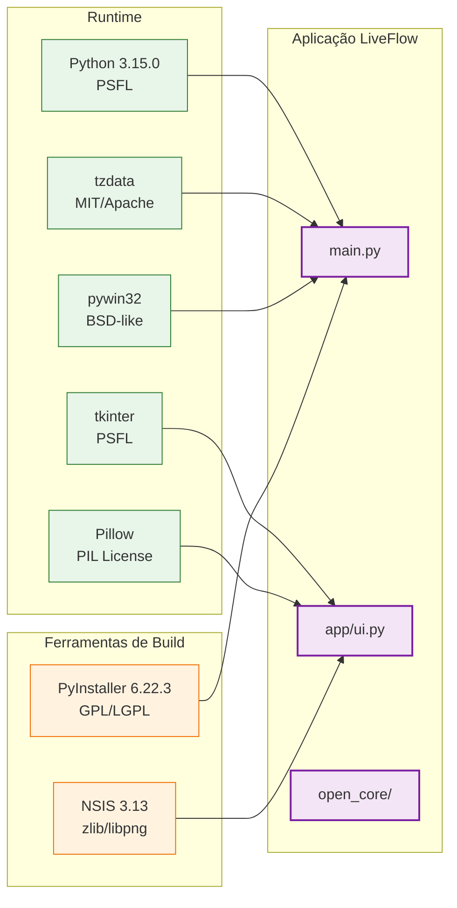

# LiveFlow v1.0.0-rc.1 — Diagrama Arquitetural (Mermaid)

Diagramas refletindo a arquitetura real do repositório RC.1.

---

## 1. Arquitetura Geral do LiveFlow

```mermaid
graph TD
    %% Pontos de entrada e camadas superiores
    User[Usuário Final] --> UI[Janela Principal Tkinter<br/>app/ui.py]
    
    %% Camada de interface
    UI --> Sidebar[Sidebar e Navegação<br/>app/ui.py]
    UI --> Dashboard[Dashboard<br/>app/ui.py]
    UI --> Themes[Tema Claro/Escuro/Auto<br/>app/theme_manager.py]
    UI --> Donations[Modal Doações PIX/BTC/SOL<br/>app/donations.py]
    
    %% Camada de serviços
    UI --> Auth[Autenticação OAuth Google<br/>app/]
    UI --> Sync[Sincronização de Dados<br/>app/]
    UI --> Sched[Agendamento Transmissões<br/>app/]
    UI --> YT[YouTube Data API<br/>app/]
    UI --> OBS[Integração OBS<br/>app/]
    UI --> Persist[Persistência Local SQLite/DPAPI<br/>app/]
    UI --> Update[Sistema de Atualizações<br/>app/]
    UI --> Diag[Diagnósticos<br/>app/]
    
    %% Núcleo Open Core
    UI --> Core[open_core/recurrence.py<br/>Algoritmos de Recorrência]
    
    %% Recursos
    UI --> Assets[assets/<br/>liveflow.ico, liveflow.png,<br/>oauth_client.json]
    
    %% Executável e instalador
    PyInstaller[PyInstaller 6.22.3] --> EXE[LiveFlow.exe]
    NSIS[NSIS 3.13] --> Installer[LiveFlow-Setup-x64.exe]
    
    classDef proprietary fill:#ffcccc,stroke:#ff0000,stroke-width:2px;
    classDef opensource fill:#ccffcc,stroke:#00ff00,stroke-width:2px;
    classDef thirdparty fill:#ccccff,stroke:#0000ff,stroke-width:1px;
    classDef integration fill:#ffffcc,stroke:#ffaa00,stroke-width:2px;
    
    class UI,Auth,Sync,Sched,YT,OBS,Persist,Update,Diag proprietary;
    class Core opensource;
    class PyInstaller,NSIS thirdparty;
    class Sidebar,Dashboard,Themes,Donations integration;
```

---

## 2. Separação entre Componentes Proprietários e Open Source

---

## 3. Comunicação entre as Camadas

---

## 4. Fluxo de Inicialização

---

## 5. Dependências Principais

---

## 6. Observações sobre os Diagramas

- Esses diagramas refletem a **estrutura real** observada no repositório RC.1, não uma arquitetura idealizada.
- Classificações como "Proprietário" e "Open Source" são **propostas sujeitas à confirmação jurídica**.
- A pasta `open_core/` não representa a totalidade do modelo de licenciamento.
- Arquivos em `assets/private/` são excluídos do versionamento via `.gitignore`.

---

*Fim dos diagramas arquiteturais*
